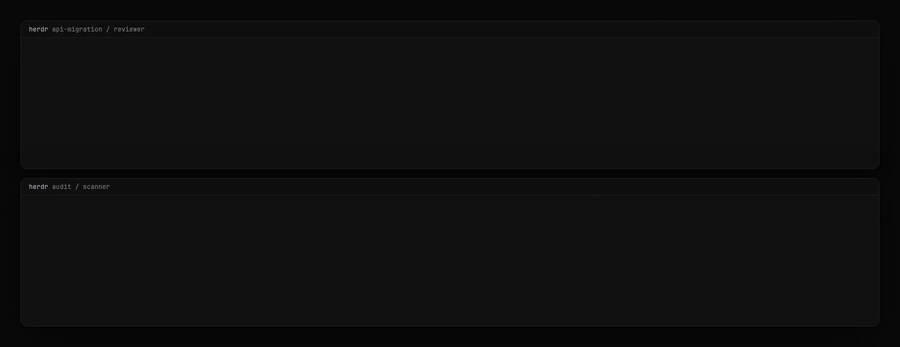

# Clause

A floating board that shows what your coding agents decided, across every herdr workspace and pane.

<p align="center">
  
</p>

## Why Clause?

During Claude Code sessions, you accumulate scratch context: decisions made, warnings to remember, TODOs to track. This context lives in your head or gets buried in terminal output. Clause gives it a visible, structured home: agents post to it, and you read it, check items off and add private memos, in real time.

## What it does

Clause is a floating scratchpad that lives alongside your terminal. Coding agents push notes, todos, warnings and decision headlines to it via MCP tools. When agents run in parallel inside [herdr](https://herdr.dev), the panel groups their notes by workspace and pane, so you can see which agent sent which decision and ask it for details. You can also add your own notes directly.

## How it works

Clause uses a two-process architecture:

1. **`clause-mcp`** : CLI binary spawned by Claude Code as an MCP server (stdio transport)
2. **`Clause.app`** : SwiftUI floating window that manages and displays notes
3. Both processes communicate via Unix domain socket at `~/.clause/clause.sock`

The agent spawns `clause-mcp`, which connects to the running `Clause.app` instance. All MCP tool calls are forwarded over the socket in real time.

Inside herdr, `clause-mcp` reads `HERDR_WORKSPACE_ID` and `HERDR_PANE_ID` and tags every note with them; agents never pass identity themselves. Workspace and agent names are looked up through the `herdr` CLI and shown next to the IDs. Each pane only sees and changes its own notes. Outside herdr, notes go to a `local:<directory>` workspace named after the agent's working directory.

## MCP Tools

| Tool          | Description                                                              |
| ------------- | ------------------------------------------------------------------------ |
| `add_note`    | Add a note, todo, warning, or decision (`status`: `sent` or `decided`)   |
| `list_notes`  | List this pane's notes, each with a short ref such as `D-12`             |
| `edit_note`   | Update one of this pane's notes by UUID or ref, e.g. mark `D-12` decided |
| `delete_note` | Remove one of this pane's notes by UUID or ref                           |
| `clear_notes` | Clear this pane's notes                                                  |

Each pane keeps its 5 most recent decided decisions; older ones drop off the board.

Every note has a ref (`N-3`, `T-4`, `W-8`, `D-12`) that is never reused; click it in the panel to copy it, then ask the agent "what is D-12?". Decisions can also carry a private memo, added and edited from the panel only; agents never see it ([ADR-002](docs/adr/ADR-002-note-refs-and-private-memos.md)).

## Requirements

- macOS 14+ (Sonoma)
- Xcode 16+
- Swift 6

## Quick Start

```bash
git clone https://github.com/ceaksan/clause.git
cd clause
brew install xcodegen && xcodegen generate
open Clause.xcodeproj
```

Build and run the **Clause** scheme in Xcode, then add `clause-mcp` to your Claude Code config:

```json
{
  "mcpServers": {
    "clause": {
      "command": "/path/to/Clause.app/Contents/MacOS/clause-mcp"
    }
  }
}
```

Replace `/path/to/Clause.app` with the actual path to the built app bundle.

### Upgrading from protocol 1

The herdr board release changes the socket protocol to version 2. An older `clause-mcp` binary gets `versionMismatch` on every call. Quit the running Clause.app, replace both the app and `clause-mcp` (the path your MCP config points to), start the app, then restart agent sessions so they spawn the new `clause-mcp`. The old `~/.clause/sessions/` directory is no longer used.

## Building

```bash
xcodebuild -scheme Clause -configuration Debug build
xcodebuild -scheme ClauseMCP -configuration Debug build
```

## Testing

```bash
xcodebuild test -scheme Clause -destination 'platform=macOS'
xcodebuild test -scheme ClauseShared -destination 'platform=macOS'
```

## Architecture

See [architecture.md](architecture.md) for full technical details.

## Roadmap

- [x] Milestone 1: CLI MCP server + floating window + bidirectional IPC
- [x] herdr board: multi-workspace, multi-pane notes and decisions ([ADR-001](docs/adr/ADR-001-herdr-multi-workspace-board.md))
- [ ] Milestone 2:
  - Global hotkey (Cmd+Shift+N) to capture clipboard content as a note
  - Accessibility permission handling with fallback UI
  - Pin/unpin floating window (toggle already built)
  - Note search and filtering in the UI
  - `completed` filter for `list_notes` tool
- [ ] Milestone 3: Distribution (DMG, Homebrew cask, code signing)

## Tech Stack

Swift 6, SwiftUI, AppKit, POSIX sockets, [modelcontextprotocol/swift-sdk](https://github.com/modelcontextprotocol/swift-sdk)

## Author

[@ceaksan](https://x.com/ceaksan) / [Bluesky](https://bsky.app/profile/ceaksan.com)

## License

MIT
